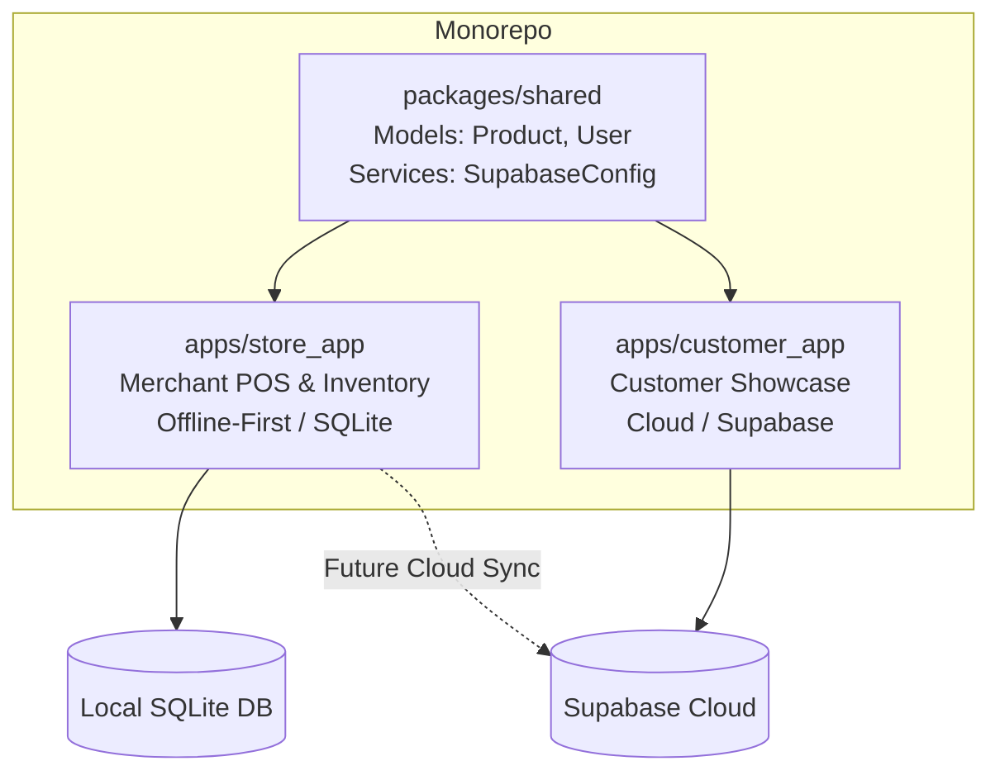
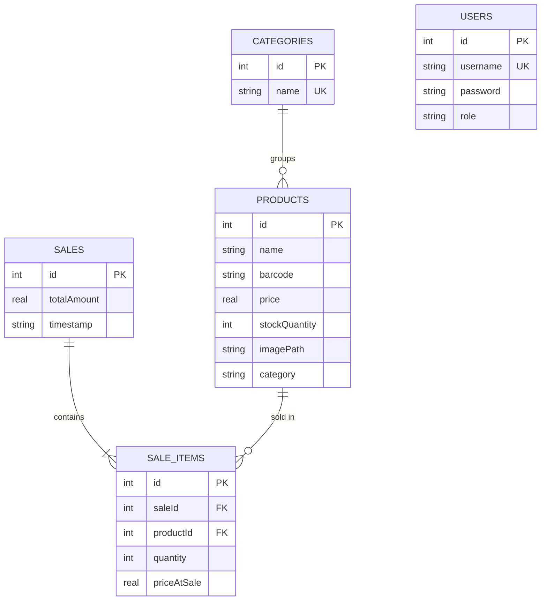

# SMART_PDV (JL Tabacaria) - System Architecture & Engineering Guide

Welcome to the **SMART_PDV** engineering team! This document provides a comprehensive technical overview of the system architecture, design decisions, data models, key subsystems, workflows, and developer conventions across the codebase.

---

## 1. Executive Summary & Vision

**SMART_PDV** is a retail Point of Sale (POS) and inventory management platform specifically tailored for tobacco shops (*tabacarias*). It addresses unique retail challenges including fast-paced barcode scanning, OCR product identification for merchandise with small or complex labels, offline-first reliability, thermal receipt printing, and catalog browsing for end-customers.

The repository is structured as an **offline-capable monorepo** containing two decoupled Flutter applications and a shared domain package:
1. **Store App (`apps/store_app`)**: The merchant/cashier workstation application used on physical Android devices for checkout, inventory management, OCR/barcode product registration, sales reports, and local database management.
2. **Customer App (`apps/customer_app`)**: The customer-facing digital showcase and product catalog connected to Supabase for real-time browsing.
3. **Shared Package (`packages/shared`)**: The single source of truth for core data models and shared infrastructure configuration.



---

## 2. Monorepo Directory Layout

```
SMART_PDV/
├── apps/
│   ├── store_app/                      # POS & Merchant Application
│   │   ├── android/                    # Native Android configurations & manifest
│   │   ├── lib/
│   │   │   ├── models/                 # Store-specific models (Sale, SaleItem)
│   │   │   ├── providers/              # ChangeNotifier state providers
│   │   │   │   ├── auth_provider.dart
│   │   │   │   ├── product_provider.dart
│   │   │   │   └── sales_provider.dart
│   │   │   ├── screens/                # UI screens and dialogs
│   │   │   │   ├── add_product_screen.dart
│   │   │   │   ├── category_management_screen.dart
│   │   │   │   ├── home_screen.dart
│   │   │   │   ├── inventory_screen.dart
│   │   │   │   ├── live_ocr_scanner_screen.dart
│   │   │   │   ├── login_screen.dart
│   │   │   │   ├── reports_screen.dart
│   │   │   │   └── sales_screen.dart
│   │   │   ├── services/               # Device & infrastructure integrations
│   │   │   │   ├── backup_service.dart
│   │   │   │   ├── database_helper.dart
│   │   │   │   ├── ocr_service.dart
│   │   │   │   └── receipt_service.dart
│   │   │   └── main.dart               # Store app entry point
│   │   └── pubspec.yaml                # Package: pdv_jl_tabacaria
│   │
│   └── customer_app/                   # Customer Catalog Application
│       ├── lib/
│       │   └── main.dart               # Customer app entry point & catalog
│       └── pubspec.yaml                # Package: customer_app
│
├── packages/
│   └── shared/                         # Domain layer shared by both apps
│       ├── lib/
│       │   ├── src/
│       │   │   ├── models/
│       │   │   │   ├── product.dart    # Product model with resilient serialization
│       │   │   │   └── user.dart       # User model with role-based attributes
│       │   │   └── services/
│       │   │       └── supabase_config.dart # Cloud API keys & endpoints
│       │   └── shared.dart             # Package export barrel
│       └── pubspec.yaml                # Package: shared
│
├── .idea/runConfigurations/            # Android Studio run configurations
├── .vscode/launch.json                 # VS Code debugging configurations
├── FEATURES.md                         # Feature tracker
└── README.md
```

---

## 3. Technology Stack & Key Libraries

| Component | Technology / Library | Purpose |
| :--- | :--- | :--- |
| **Framework** | Flutter 3.44+ / Dart 3.12+ | Cross-platform mobile development (optimized for Android) |
| **State Management** | `provider` (`ChangeNotifier`) | Reactive UI updates across screens |
| **Local Database** | `sqflite`, `path` | High-performance, offline-first SQLite persistence |
| **Cloud Backend** | `supabase_flutter`, `flutter_dotenv` | Remote database, authentication, and product sync |
| **Barcode Scanning** | `mobile_scanner` | Camera-based barcode and QR code reading |
| **Text Recognition** | `google_mlkit_text_recognition` | On-device machine learning OCR for product packaging |
| **Printing & PDF** | `pdf`, `printing` | Thermal receipt generation (80mm roll format) |
| **Backups & Sharing**| `share_plus`, `path_provider` | Native OS sharing for database backups |
| **Typography & Theme**| `google_fonts` (Outfit) | Dark-mode retail aesthetic tailored for readability |

---

## 4. Data Layer & Database Schema

### 4.1 Local SQLite Schema (`apps/store_app`)
Implemented in [`DatabaseHelper`](file:///c:/Users/Admin/DEV/SMART_PDV/apps/store_app/lib/services/database_helper.dart) (`pos_system.db`, Version 2).



### 4.2 Data Models & Serialization Resilience

#### [Product](file:///c:/Users/Admin/DEV/SMART_PDV/packages/shared/lib/src/models/product.dart)
Located in `packages/shared`. Defines:
- `id` (`int?`): Unique primary key generated by SQLite or Supabase.
- `name` (`String`): Item name.
- `barcode` (`String?`): Optional EAN-13, EAN-8, or UPC code.
- `price` (`double`): Sales price per unit.
- `stockQuantity` (`int`): Physical inventory count.
- `imagePath` (`String?`): Local file path or cloud URL.
- `category` (`String?`): Category classification.

> [!IMPORTANT]
> **Numeric Type Resilience**: SQLite and JSON APIs often serialize whole numbers (`10.0`) as integers (`10`), or numeric columns as strings. `Product.fromMap` uses type-safe coercion:
> ```dart
> price: (map['price'] is num) 
>     ? (map['price'] as num).toDouble() 
>     : double.tryParse(map['price']?.toString() ?? '') ?? 0.0
> ```
> This prevents runtime casting exceptions and ensures prices never default to zero unexpectedly.

#### [Sale & SaleItem](file:///c:/Users/Admin/DEV/SMART_PDV/apps/store_app/lib/models/sale.dart)
Located in `apps/store_app`. Defines transaction history and line items. Checkout operations execute in an atomic transaction:
1. `txn.insert('sales', ...)`
2. For each cart item:
   - `txn.insert('sale_items', ...)`
   - `txn.execute('UPDATE products SET stockQuantity = stockQuantity - ? WHERE id = ?', ...)`

---

## 5. Core Architectural Subsystems

### 5.1 Point of Sale & Direct Checkout (`sales_screen.dart`)
- **Active Cart Flow**: Cashiers scan items or search the catalog using [`ProductSearchDialog`](file:///c:/Users/Admin/DEV/SMART_PDV/apps/store_app/lib/screens/sales_screen.dart).
- **Scanner Modal**: Integrated [`MobileScanner`](file:///c:/Users/Admin/DEV/SMART_PDV/apps/store_app/lib/screens/sales_screen.dart) with instant camera wake-up and barcode lookup.
- **OCR Matching**: In absence of a barcode, cashiers can use the OCR scanner to find products by detected brand name.
- **Receipt Dispatch**: Upon finalizing checkout, [`ReceiptService`](file:///c:/Users/Admin/DEV/SMART_PDV/apps/store_app/lib/services/receipt_service.dart) builds an 80mm thermal receipt and routes it directly to printer drivers via `printing`.

### 5.2 Inventory Management & Product Registration
- **Overview Dashboard (`inventory_screen.dart`)**: Shows stock badges (highlighting low stock `< 5`), category chips, and search filtering.
- **Direct Product Editing**: Tapping any card or edit button opens `_showEditProductDialog` allowing instantaneous adjustments to **Price**, **Stock Quantity**, **Name**, and **Category** directly in the list.
- **Product Entry & Camera OCR (`add_product_screen.dart`)**:
  - Live top-pinned camera scanning frame with torch toggle.
  - Automatic `_handleDetectedBarcode` lookup. When an item is already recognized in the database, the screen switches to update mode (`_existingProductId != null`) and presents an **"ATUALIZAR PRODUTO"** action instead of duplicating records.
  - OCR name extraction via [`OcrService`](file:///c:/Users/Admin/DEV/SMART_PDV/apps/store_app/lib/services/ocr_service.dart), filtering out common Brazilian tobacco warning labels (*"MINISTÉRIO DA SAÚDE ADVERTE"*).
  - Robust multi-format currency parsing supporting Brazilian currency formats (`R$ 10,00`), standard commas (`10,00`), decimals (`10.00`), and integers (`10`).
  - Validation rule guaranteeing `price > 0` before submission.

### 5.3 Hardware & Services
- **Database Backup (`backup_service.dart`)**: Retrieves the raw SQLite `.db` file path and presents Android's native share sheet via `share_plus` to export backups to Google Drive, WhatsApp, or local storage.
- **Thermal Printing (`receipt_service.dart`)**: Generates PDF receipts matching `PdfPageFormat.roll80` thermal paper specifications.

---

## 6. Developer Setup & How to Run

### 6.1 Prerequisites
- Flutter SDK 3.44+ (channel stable)
- Android Studio / VS Code with Flutter extensions
- Android device or emulator (API 24+)

### 6.2 Workspace Dependencies
From the repository root:
```bash
# Get dependencies for shared package
cd packages/shared
flutter pub get

# Get dependencies for store app
cd ../../apps/store_app
flutter pub get

# Get dependencies for customer app
cd ../customer_app
flutter pub get
```

### 6.3 Run & Debugging Configurations

#### Option A: VS Code
Open the Run & Debug view (`Ctrl+Shift+D` / `Cmd+Shift+D`). Two pre-configured targets are ready:
- **`Store App`**: Launches `apps/store_app/lib/main.dart`
- **`Customer App`**: Launches `apps/customer_app/lib/main.dart`

#### Option B: Android Studio
Run configurations are committed under `.idea/runConfigurations/`:
- Select **`store_app`** from the run configuration dropdown and press **Run (Shift+F10)**.
- Select **`customer_app`** to launch the customer showcase independently.

#### Option C: Flutter CLI
```bash
# Run Store App
cd apps/store_app
flutter run

# Run Customer App
cd apps/customer_app
flutter run
```

---

## 7. Important Notes & Handover Checklist for Incoming Engineers

> [!NOTE]
> **Authentication Bypass**: During active device field-testing, the login screen in `apps/store_app/lib/main.dart` was bypassed to immediately display `HomeScreen()`, and `isAdmin` was hardcoded to `true` in `home_screen.dart`. When preparing for production deployment, re-enable `Consumer<AuthProvider>` in `main.dart` and bind role checking to `auth.currentUser?.role == 'admin'`.

> [!TIP]
> **Extending the Shared Package**: Any models intended to be read by both merchant and customer applications (such as promotional banners, customer loyalty points, or catalog items) must be defined inside [`packages/shared`](file:///c:/Users/Admin/DEV/SMART_PDV/packages/shared) and exported via `shared.dart`.

> [!IMPORTANT]
> **Local Database Migrations**: If you modify the SQLite schema in [`DatabaseHelper`](file:///c:/Users/Admin/DEV/SMART_PDV/apps/store_app/lib/services/database_helper.dart), remember to increment `version` in `_initDB` and implement an `_onUpgrade` step to ensure existing merchant physical devices update without data loss.
